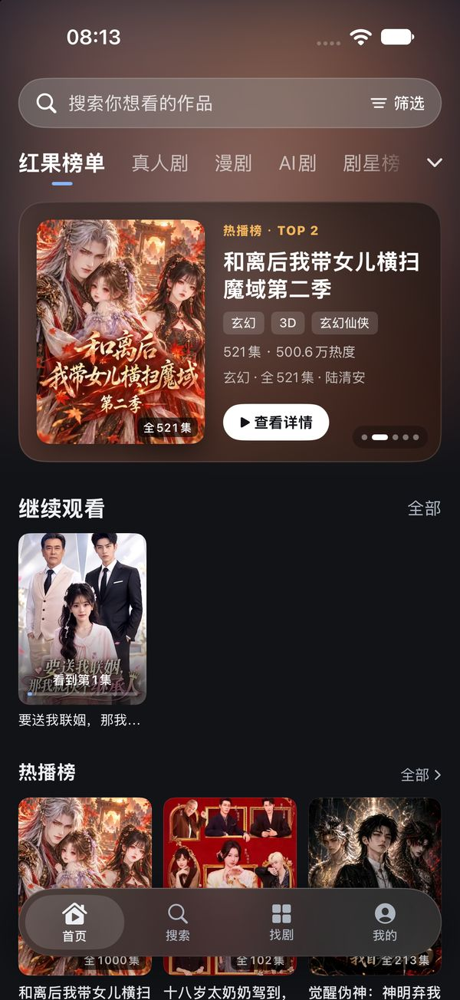
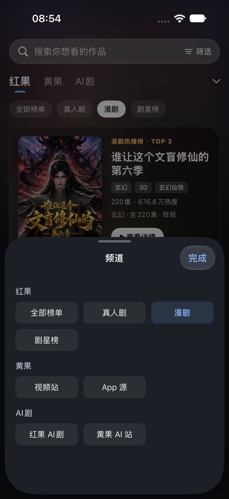
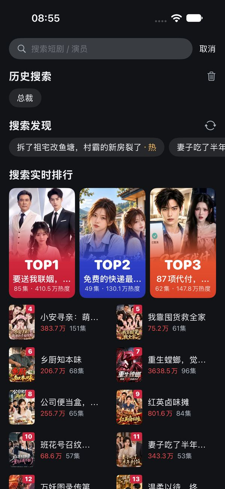
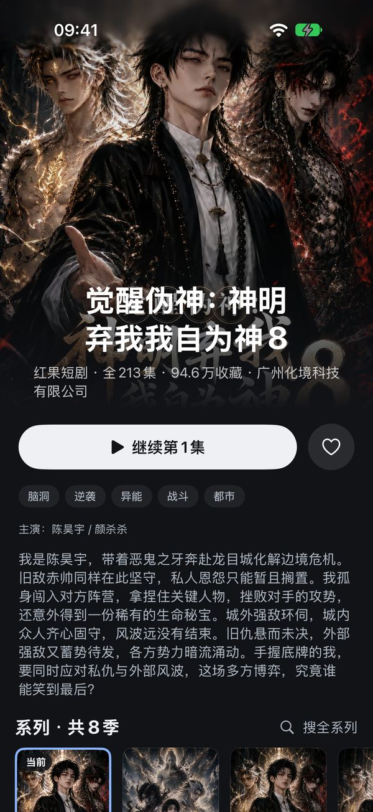
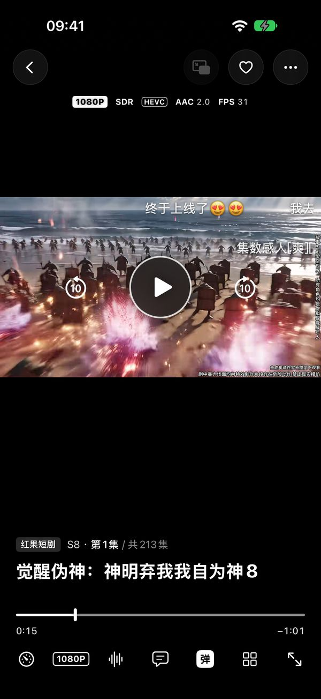
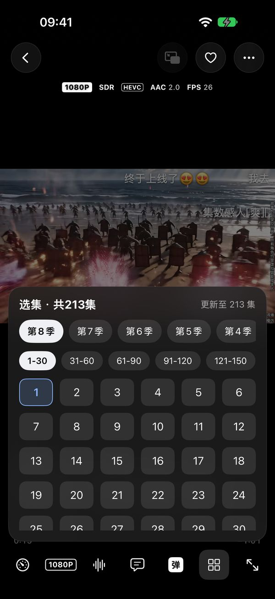
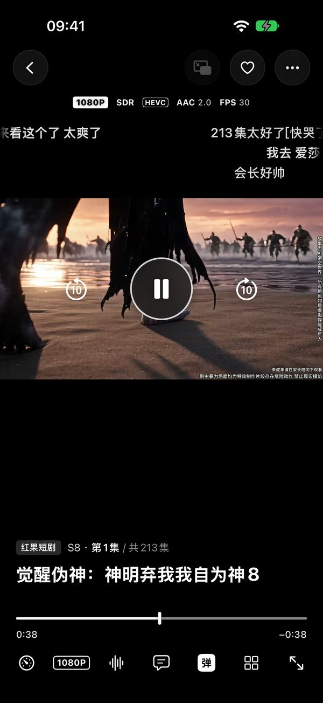
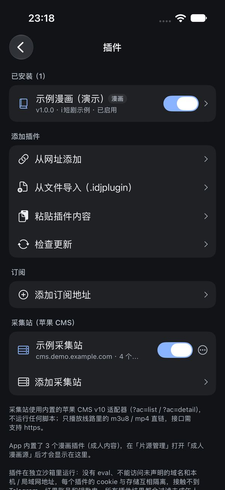
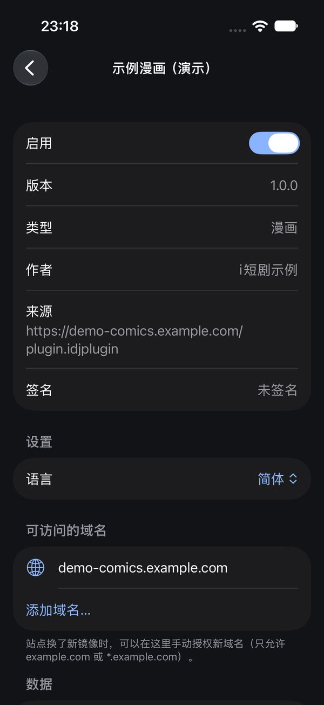
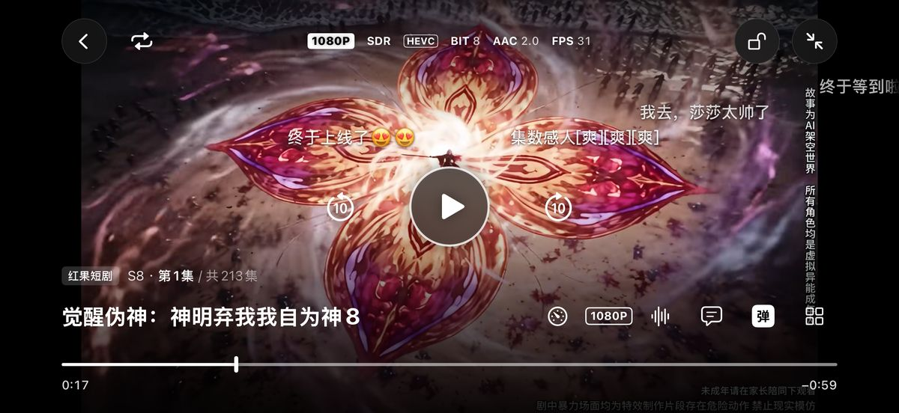

# i短剧 (iDuanJu)

> **本项目完全免费、开源，禁止任何形式的付费分发 / 售卖。**
> 本项目以 **GPL-3.0** 协议发布：任何使用、修改、衍生本项目代码的作品，都必须同样以 GPL-3.0 开源并公开完整源代码。
> 如果你是花钱买到本 App 或本代码的，你被骗了，请举报卖家。

i短剧 是一个原生 SwiftUI 编写的 iOS 多源短剧 / 视频 / 漫画 / Telegram 频道聚合播放器。App 本身**不托管任何内容**，
所有数据都由你的设备直接向各个公开站点请求。

## 功能

- **内置源**：红果短剧（本地签名、匿名设备）、黄果（AI 短剧 / 视频）、Telegram 频道（网页预览 + 可选 TDLib 登录）
- **长视频站点**（18+，默认关闭）：MissAV、Jable、SupJav、Hanime1、Pornhub、XVideos、Eporner 等
- **漫画**：MangaDex、包子漫画，以及 JS 插件（manga18fx / komikindo / 18comic，18+，默认关闭）
- **JS 插件系统**：基于 QuickJS 的沙箱，每个插件独立运行、只能访问自己声明且你同意过的域名，cookie / 存储互相隔离，
  不能 `eval`、访问不到本机和内网。支持从网址 / 文件 / 粘贴添加，以及订阅列表。规范见 [`docs/plugins/SPEC_ZH.md`](docs/plugins/SPEC_ZH.md)
- **苹果 CMS v10 采集站**通用适配（m3u8 / mp4 直链）
- **播放器**：自绘控制层、竖屏默认 / 旋转或手动横屏、亮度音量手势、倍速、画质 / 线路切换、选集、弹幕、跳过片头、
  预缓冲、本地 HLS 代理、CENC 解密、Telegram 视频边下边播（TDLib Range 流式）
- **Cloudflare 验证**：隐藏 WebView 自动过验证（每个插件独立）

## 截图

> 模拟器截图，内容均为红果公开短剧及演示插件。

| 首页 | 频道切换 | 搜索 | 详情 |
|:---:|:---:|:---:|:---:|
|  |  |  |  |
| **竖屏播放** | **选集** | **弹幕** | **插件管理** |
|  |  |  |  |
| **插件详情与权限** | | | |
|  | | | |

**横屏播放**



## 编译

要求：macOS + Xcode 16 或更新、[XcodeGen](https://github.com/yonaskolb/XcodeGen)，最低支持 **iOS 17.0**
（之后切换到 AetherEngine 播放内核时会升到 iOS 18）。

```bash
brew install xcodegen
git clone https://github.com/my-name-is-alan/iDuanJu.git && cd iDuanJu
xcodegen generate          # 生成 STV.xcodeproj（工程文件不入库）
open STV.xcodeproj         # 或命令行：
xcodebuild -project STV.xcodeproj -scheme STV -sdk iphonesimulator \
  -destination 'generic/platform=iOS Simulator' CODE_SIGNING_ALLOWED=NO build
```

依赖会由 Swift Package Manager 自动拉取：TDLibKit（含预编译 TDLib，首次拉取较大）；QuickJS-ng 已 vendored 在 `Packages/QuickJS`。

### 打包未签名 IPA（侧载）

```bash
scripts/package.sh            # 输出到 ./dist/STV-<版本>-unsigned.ipa
```

未签名 IPA 用 AltStore / Sideloadly / TrollStore 等工具用你自己的 Apple ID 重签后安装。

## Telegram（TDLib）登录

公开频道走 t.me 网页预览，不需要登录。私有 / 受限频道、频道内搜索需要 TDLib 登录：

1. 到 <https://my.telegram.org> → API development tools 申请你自己的 `api_id` / `api_hash`
2. App 内「我的 → 片源管理 → Telegram 登录」填入，再用手机号 + 验证码登录

本仓库**不内置任何 api_id / api_hash**，凭据只保存在你设备的钥匙串里。

## 红果设备

红果使用每台设备本地生成的匿名设备，仓库内不附带任何设备 ID。如果上游拒绝新生成的设备，可以在
UserDefaults 键 `stv.hg.purePlayerDevice` 写入你自己的 `"<device_id>,<iid>"`。

## 成人内容

成人站点 / 频道 / 漫画插件**默认全部关闭**，需要在「我的 → 片源管理」中手动开启（可选开启 Face ID 锁，冷启动后重新隐藏）。仅限已满 18 周岁且所在地法律允许的用户使用。

## 免责声明

- 本项目仅供个人学习、研究 iOS / Swift / 网络协议使用，**不提供、不存储、不分发**任何视频、图片或漫画内容。
- 所有内容版权归原站点和权利人所有。使用时请遵守各站点的服务条款及你所在地的法律法规，由此产生的一切后果由使用者自行承担。
- 项目中对第三方接口的适配仅用于互通性研究，与相关平台无任何关联。如有权利人认为侵权，请提 issue 联系处理。

## 许可证

[GPL-3.0](LICENSE)。第三方组件及其许可见 [`THIRD_PARTY_NOTICES.md`](THIRD_PARTY_NOTICES.md)。

**禁止付费分发**：本项目是免费软件，作者不授权任何人以收费方式出售、分发本 App 或其代码。任何衍生作品都必须以 GPL-3.0 公开源代码。

---

## English

**iDuanJu** is a native SwiftUI iOS aggregator/player for short dramas, videos, manga and Telegram channels, with a
sandboxed QuickJS plugin system (per-plugin domain allow-list, isolated cookies/storage, no `eval`). It hosts no content.

- Build: `xcodegen generate`, then build the `STV` scheme in Xcode (iOS 17.0+). Sideload the unsigned IPA from `scripts/package.sh`.
- Telegram login uses **your own** `api_id` / `api_hash` from my.telegram.org; none are bundled.
- Adult (18+) sources are off by default and require explicit unlock.
- For personal study only; respect each site's Terms of Service and your local laws.
- **License: GPL-3.0.** This project is free. **Selling or paid distribution is prohibited**; any derivative work must stay open source under GPL-3.0.
